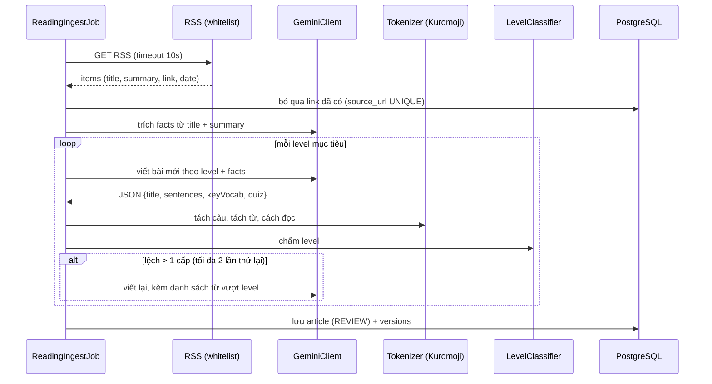

# PHASE 1 – DATABASE SCHEMA & PIPELINE INGEST

> **Mục tiêu**: Có bảng dữ liệu và một pipeline chạy được end-to-end: RSS → facts → bài viết theo từng level → lưu DB (trạng thái `REVIEW`).
> **Phụ thuộc**: Phase 0 · **Package backend**: `com.nihongo.api.modules.reading.article` (đặt cạnh `reading` – nơi đã có `SentenceBreakdownService`)

---

## 1.1 Schema – Flyway `V35__create_reading_articles.sql`

Giữ ít bảng nhất có thể: câu và từ khóa là dữ liệu chỉ đọc theo từng phiên bản → lưu `jsonb`, không tách bảng.

```sql
CREATE TABLE reading_articles (
    id              BIGSERIAL PRIMARY KEY,
    source_name     VARCHAR(50)  NOT NULL,          -- 'NHK', 'YAHOO', 'WIKINEWS'
    source_url      TEXT         NOT NULL UNIQUE,   -- link bài gốc (dùng để ghi nguồn + chống trùng)
    source_title    TEXT         NOT NULL,
    source_published_at TIMESTAMPTZ,
    category        VARCHAR(30)  NOT NULL,          -- SOCIETY, LIFE, ECONOMY, SCI_TECH, SPORTS, CULTURE, WEATHER
    facts           JSONB        NOT NULL,          -- ["fact 1", "fact 2", ...] (đã trích, không phải văn bản gốc)
    status          VARCHAR(20)  NOT NULL DEFAULT 'REVIEW', -- REVIEW | PUBLISHED | REJECTED
    created_at      TIMESTAMPTZ  NOT NULL DEFAULT NOW(),
    published_at    TIMESTAMPTZ
);

CREATE TABLE reading_article_versions (
    id              BIGSERIAL PRIMARY KEY,
    article_id      BIGINT       NOT NULL REFERENCES reading_articles(id) ON DELETE CASCADE,
    jlpt_level      VARCHAR(5)   NOT NULL,          -- level mục tiêu: N5..N1
    title_ja        TEXT         NOT NULL,
    title_vi        TEXT,
    sentences       JSONB        NOT NULL,          -- [{idx, text, translationVi, tokens:[{s,r,l,pos,lv}], audioUrl, durationMs}]
    key_vocab       JSONB        NOT NULL DEFAULT '[]',
    char_count      INT          NOT NULL,
    computed_level  VARCHAR(5),                     -- kết quả classifier (Phase 2)
    level_metrics   JSONB,                          -- độ phủ từ vựng/Kanji theo level, độ dài câu...
    voice_name      VARCHAR(20)  NOT NULL DEFAULT 'Kore', -- Random 'Kore' (Nữ) hoặc 'Puck' (Nam) của Gemini TTS
    audio_status    VARCHAR(20)  NOT NULL DEFAULT 'PENDING', -- PENDING | READY | FAILED
    UNIQUE (article_id, jlpt_level)
);
CREATE INDEX idx_rav_level ON reading_article_versions(jlpt_level);

CREATE TABLE user_reading_progress (
    user_id         BIGINT       NOT NULL REFERENCES users(id) ON DELETE CASCADE,
    version_id      BIGINT       NOT NULL REFERENCES reading_article_versions(id) ON DELETE CASCADE,
    completed_at    TIMESTAMPTZ  NOT NULL DEFAULT NOW(),
    reading_seconds INT,
    PRIMARY KEY (user_id, version_id)
);
```

- [ ] Viết migration V35 (kiểm tra lại số version mới nhất trước khi tạo – hiện tại là V34)
- [ ] Kiểm tra tên bảng `users` và kiểu khóa chính trùng khớp schema hiện có
- [ ] Entity JPA hoặc `JdbcTemplate` – **theo cách các module gần nhất đang làm** (`AiSavedCardService` dùng `JdbcTemplate`, phù hợp với cột `jsonb`)
- [ ] `mvn -q test` pass, Flyway chạy sạch trên DB dev

---

## 1.2 Pipeline ingest



### Việc cần làm
- [ ] `ReadingRssClient`: đọc RSS bằng XML parser có sẵn của JDK (`javax.xml` / StAX) – **không thêm thư viện** nếu không cần
  - [ ] Chỉ gọi tới host trong whitelist (chống SSRF), timeout 10 s, giới hạn dung lượng phản hồi
  - [ ] Tắt DTD/external entity khi parse XML (chống XXE)
- [ ] `ReadingContentGenerator`: dùng `GeminiClient` có sẵn trong module translator
  - [ ] Prompt trích facts (trả về JSON list)
  - [ ] Prompt viết bài theo level (đầu vào: facts + level + danh sách từ/ngữ pháp cho phép + độ dài mục tiêu)
  - [ ] Ràng buộc đầu ra JSON, validate bằng Jackson; JSON hỏng → thử lại 1 lần rồi đánh dấu lỗi
  - [ ] Nội dung RSS được truyền vào prompt như **dữ liệu** (đóng khung rõ ràng), không cho phép nó đổi chỉ dẫn (chống prompt injection)
- [ ] `JapaneseTokenizer` (bọc Kuromoji): tách câu theo `。！？`, trả token `{surface, reading(hiragana), lemma, pos}`
- [ ] Kiểm tra chống sao chép: tỉ lệ trùng 8-gram ký tự giữa bài sinh ra và tiêu đề/tóm tắt RSS < ngưỡng (ví dụ 15%) – vượt thì viết lại
- [ ] `ReadingIngestJob`
  - [ ] `@Scheduled` (ví dụ 06:00 hằng ngày) + bật/tắt bằng property `reading.ingest.enabled`
  - [ ] Endpoint admin `POST /api/v1/admin/reading/ingest` để chạy tay
  - [ ] Giới hạn số sự kiện/lần chạy (theo quyết định Phase 0)
  - [ ] Log ngắn gọn: số bài lấy / sinh / lỗi; không log API key
- [ ] Endpoint admin duyệt bài: `GET /admin/reading/articles?status=REVIEW`, `POST /admin/reading/articles/{id}/publish|reject`

> [!WARNING]
> `SecurityConfig` hiện đang để `/api/v1/admin/**` là `permitAll()`. Các endpoint admin mới của module này (chạy ingest tốn tiền Gemini/TTS, publish bài) **phải** yêu cầu quyền ADMIN (ví dụ `@PreAuthorize("hasRole('ADMIN')")` hoặc rule riêng đặt **trước** rule `permitAll` của admin). Nên xử lý luôn lỗ hổng chung này trong Phase 7.

### Kiểm thử
- [ ] Unit test parse RSS mẫu (file XML trong `src/test/resources`), gồm cả XML có DOCTYPE độc hại
- [ ] Unit test tách câu/tách từ với 3 câu mẫu (có số, katakana, tên riêng)
- [ ] Unit test check chống sao chép (1 case giống, 1 case khác)
- [ ] Integration: chạy ingest với GeminiClient được mock → có 1 article + N versions trong DB

---

## ✅ ĐIỀU KIỆN HOÀN THÀNH PHASE 1
- [ ] Migration V35 chạy được, `mvn -q test` pass
- [ ] Gọi `POST /api/v1/admin/reading/ingest` (với tài khoản admin) sinh được ≥ 1 sự kiện × các level đã chốt, trạng thái `REVIEW`
- [ ] Gọi bằng tài khoản không phải admin → 403
- [ ] `graphify update .`
