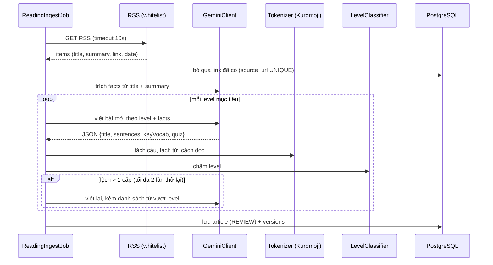

# PHASE 1 – DATABASE SCHEMA & PIPELINE INGEST

> **Mục tiêu**: Có bảng dữ liệu và một pipeline chạy được end-to-end: RSS → facts → bài viết theo từng level → lưu DB (trạng thái `REVIEW`).
> **Phụ thuộc**: Phase 0 · **Package backend**: `com.nihongo.api.modules.reading.article` (đặt cạnh `reading` – nơi đã có `SentenceBreakdownService`)

---

## 1.1 Schema – Flyway `V35__create_reading_articles.sql`

Giữ ít bảng nhất có thể: câu và từ khóa là dữ liệu chỉ đọc theo từng phiên bản → lưu `jsonb`, không tách bảng.

```sql
CREATE TABLE reading_articles (
    id              BIGSERIAL PRIMARY KEY,
    source_name     VARCHAR(50)  NOT NULL,          -- 'NHK', 'YAHOO', 'WIKINEWS'
    source_url      TEXT         NOT NULL UNIQUE,   -- link bài gốc (dùng để ghi nguồn + chống trùng)
    source_title    TEXT         NOT NULL,
    source_published_at TIMESTAMPTZ,
    category        VARCHAR(30)  NOT NULL,          -- SOCIETY, LIFE, ECONOMY, SCI_TECH, SPORTS, CULTURE, WEATHER
    facts           JSONB        NOT NULL,          -- ["fact 1", "fact 2", ...] (đã trích, không phải văn bản gốc)
    status          VARCHAR(20)  NOT NULL DEFAULT 'REVIEW', -- REVIEW | PUBLISHED | REJECTED
    created_at      TIMESTAMPTZ  NOT NULL DEFAULT NOW(),
    published_at    TIMESTAMPTZ
);

CREATE TABLE reading_article_versions (
    id              BIGSERIAL PRIMARY KEY,
    article_id      BIGINT       NOT NULL REFERENCES reading_articles(id) ON DELETE CASCADE,
    jlpt_level      VARCHAR(5)   NOT NULL,          -- level mục tiêu: N5..N1
    title_ja        TEXT         NOT NULL,
    title_vi        TEXT,
    sentences       JSONB        NOT NULL,          -- [{idx, text, translationVi, tokens:[{s,r,l,pos,lv}], audioUrl, durationMs}]
    key_vocab       JSONB        NOT NULL DEFAULT '[]',
    char_count      INT          NOT NULL,
    computed_level  VARCHAR(5),                     -- kết quả classifier (Phase 2)
    level_metrics   JSONB,                          -- độ phủ từ vựng/Kanji theo level, độ dài câu...
    voice_name      VARCHAR(20)  NOT NULL DEFAULT 'Kore', -- Random 'Kore' (Nữ) hoặc 'Puck' (Nam) của Gemini TTS
    audio_status    VARCHAR(20)  NOT NULL DEFAULT 'PENDING', -- PENDING | READY | FAILED
    UNIQUE (article_id, jlpt_level)
);
CREATE INDEX idx_rav_level ON reading_article_versions(jlpt_level);

CREATE TABLE user_reading_progress (
    user_id         BIGINT       NOT NULL REFERENCES users(id) ON DELETE CASCADE,
    version_id      BIGINT       NOT NULL REFERENCES reading_article_versions(id) ON DELETE CASCADE,
    completed_at    TIMESTAMPTZ  NOT NULL DEFAULT NOW(),
    reading_seconds INT,
    PRIMARY KEY (user_id, version_id)
);
```

- [x] Viết migration V35 (`V35__create_reading_articles.sql`, thêm `source_license`, bật RLS Supabase, version trước là V34)
- [x] Kiểm tra tên bảng `users` và kiểu khóa chính trùng khớp schema hiện có (`users.id` kiểu `BIGINT`)
- [x] `ReadingArticleRepository` dùng `JdbcTemplate` (đồng bộ với `AiSavedCardService`, tối ưu `jsonb`, transaction ngắn chỉ bọc bước lưu DB)
- [x] `mvn -q test -Dtest=com.nihongo.api.modules.reading.**` pass (15/15 tests), Flyway V35 chạy sạch trên DB dev (Supabase PostgreSQL 17.6)

---

## 1.2 Pipeline ingest



### Việc cần làm
- [x] `ReadingRssClient`: đọc RSS/RDF/Atom bằng XML parser có sẵn của JDK (`javax.xml.parsers.DocumentBuilderFactory`), hỗ trợ UTF-8 & Shift_JIS/MS932
  - [x] Chỉ gọi tới 7 host trong whitelist (chống SSRF, tắt redirect ra ngoài), timeout 10 s, giới hạn dung lượng 2 MB
  - [x] Tắt tuyệt đối DTD/external entity khi parse XML (chống XXE)
- [x] `ReadingContentGenerator`: dùng `GEMINI_API_KEY` xoay vòng key + fallback model (`gemini-3.1-flash-lite-preview` → `gemini-flash-lite-latest` → `gemini-2.5-flash-lite`)
  - [x] Prompt bước 1 trích facts khách quan sang tiếng Việt trung tính (Facts Firewall — không truyền văn bản gốc sang bước 2)
  - [x] Prompt bước 2 viết bài nguyên bản theo level từ facts + quy tắc bảo toàn số liệu/mốc thời gian
  - [x] Ép JSON bằng Gemini Structured Outputs (`responseSchema`), validate bằng Jackson; lỗi thử lại 1 lần
  - [x] Nội dung RSS đóng khung trong `<rss_data>` và sanitize thẻ đóng (chống prompt injection)
- [x] `JapaneseTokenizer` (bọc Kuromoji IPADIC): tách câu theo `。！？` (giữ nguyên trích dẫn `「…」`), trả token `{s, r(hiragana), l, pos, lv}`
- [x] `CopyrightGuardService`: kiểm tra 8-gram overlap **< 10%** (ngặt hơn 15% cho Production) + LCS; vượt ngưỡng tự viết lại tối đa 2 lần rồi từ chối lưu
- [x] `ReadingIngestJob` & `ReadingIngestService`
  - [x] `@EnableScheduling` + `@Scheduled` (06:00 hằng ngày) + bật/tắt bằng `reading.ingest.enabled=false` (mặc định tắt an toàn)
  - [x] Endpoint admin `POST /api/v1/admin/reading/ingest` bảo vệ kép (`SecurityConfig` `.hasRole("ADMIN")` đặt trước `permitAll` + `@PreAuthorize("hasRole('ADMIN')")`)
  - [x] Giới hạn số sự kiện/lần chạy (mặc định 5, trần cứng 10) + kill-switch nguồn `reading.rss.enabled-sources`
  - [x] Log ngắn gọn số bài lấy / trùng / tạo / lỗi; không log API key
- [x] Endpoint admin duyệt bài: `GET /api/v1/admin/reading/articles?status=REVIEW`, `POST /api/v1/admin/reading/articles/{id}/publish|reject`

> [!WARNING]
> `SecurityConfig` hiện đang để `/api/v1/admin/**` là `permitAll()`. Các endpoint admin mới của module này (`/api/v1/admin/reading/**`) **đã được bảo vệ chặt bằng cả `SecurityConfig` (đặt trước rule `permitAll`) lẫn `@PreAuthorize("hasRole('ADMIN')")`**. Phần `/api/v1/admin/**` chung sẽ rà soát ở Phase 7.

### Kiểm thử
- [x] Unit test parse RSS mẫu (`sample_rss2.xml`, `sample_rdf_gov.xml`, Shift_JIS, `malicious_xxe.xml`) + test SSRF whitelist (`ReadingRssClientTest`)
- [x] Unit test tách câu/tách từ với 3 câu mẫu có số, katakana, tên riêng (`JapaneseTokenizerTest`)
- [x] Unit test check chống sao chép: case sao chép bị chặn, case viết lại vượt qua (`CopyrightGuardServiceTest`)
- [x] Unit/Integration test ingest với mock generator + test chặn bài trùng lặp/vi phạm bản quyền (`ReadingIngestServiceTest`) + test bảo mật phân quyền (`AdminReadingControllerSecurityTest`)

---

## ✅ ĐIỀU KIỆN HOÀN THÀNH PHASE 1
- [x] Migration V35 chạy sạch trên DB dev, toàn bộ 15 unit/security test của module Reading pass
- [x] Gọi thực tế `POST /api/v1/admin/reading/ingest` (với JWT ADMIN) sinh thành công bài đọc 3 cấp độ (`N5`, `N3`, `N1`) ở trạng thái `REVIEW` trong PostgreSQL
- [x] Gọi không token hoặc bằng JWT `STUDENT` → 403 Forbidden
- [x] `graphify update .` hoàn tất (3.193 nodes, 9.219 edges)
