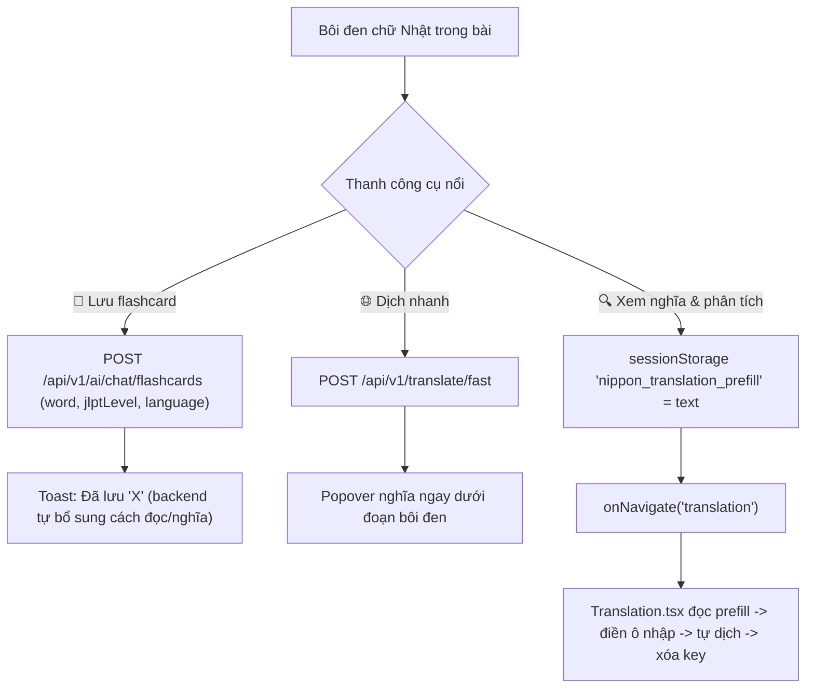

# PHASE 5 – SELECTION TOOLBAR (BÔI ĐEN → FLASHCARD / DỊCH NHANH / PHÂN TÍCH)

> **Mục tiêu**: Học viên bôi đen chữ Nhật trong bài → hiện thanh công cụ nhỏ ngay tại vị trí bôi đen với 3 nút.
> **Phụ thuộc**: Phase 4 · **Song song với**: Phase 6

---

## 5.1 Luồng người dùng

## 5.2 Tái sử dụng, không viết mới

- **Lưu flashcard**: endpoint & service đã có (`SenseiChatController` `POST /flashcards` → `AiSavedCardService.saveCard`, có `ON CONFLICT` chống trùng, tự tra cách đọc/nghĩa). Frontend gọi hàm có sẵn trong `senseiApi.ts`.
- **Dịch nhanh**: `POST /api/v1/translate/fast` (`FastTranslationService`, có cache).
- **Logic bắt selection**: `SenseiChat.tsx` đã có `selectionPopup` + `updateSelectionPopup()` dùng `window.getSelection()`. Vì giờ có **2 nơi** dùng → tách thành hook dùng chung.

## 5.3 Việc cần làm

- [x] Tách `hooks/useTextSelectionPopup.ts` từ logic hiện có trong `SenseiChat.tsx` (giữ nguyên hành vi; giới hạn trong 1 container ref; loại thẻ `<rt>/<rp>` furigana; ẩn khi cuộn/click ra ngoài)
- [x] Cập nhật `SenseiChat.tsx` dùng hook mới → kiểm tra lại tính năng lưu từ của Sensei không bị hỏng
- [x] `screens/reading/components/SelectionToolbar.tsx`
  - [x] Chỉ hiện khi đoạn bôi đen có chữ Nhật (regex Hiragana/Katakana/Kanji) và dài 1–200 ký tự
  - [x] 💾 **Lưu flashcard**: gửi `word`, `reading`/`meaning` (tự bổ sung từ `keyVocab`/Kuromoji + backend), `jlptLevel` = level bài, `language` = ngôn ngữ UI; toast thành công/lỗi; chưa đăng nhập → nhắc đăng nhập
  - [x] 🌐 **Dịch nhanh**: popover hiển thị nghĩa, nút đóng, trạng thái loading; cache theo text trong phiên để không gọi lại
  - [x] 🔍 **Xem nghĩa & phân tích**: ghi `sessionStorage` rồi `onNavigate('translation')`
  - [x] Hỗ trợ cảm ứng (mobile: `selectionchange` + `touchend` thay vì chỉ `mouseup`)
  - [x] Truy cập được bằng bàn phím, có `aria-label`
- [x] `Translation.tsx`: khi mount, đọc `nippon_translation_prefill` → `setInputText(text)` → gọi hàm dịch hiện có → `removeItem` (chỉ chạy 1 lần, xóa key ngay cả khi dịch lỗi)
- [ ] (Tùy chọn, sau MVP) lưu kèm câu ngữ cảnh vào flashcard → cần thêm cột `context_sentence` cho `ai_saved_cards` (migration riêng) – **chỉ làm nếu được duyệt**

## 5.4 Kiểm thử
- [x] `npx tsc --noEmit` pass
- [x] Browser subagent:
  - [x] Bôi đen 1 từ → Lưu → mở trang Sensei/Flashcard thấy từ đã lưu có cách đọc (`病気 (びょうき) — Bệnh tật`)
  - [x] Bôi đen 1 câu → Dịch nhanh → thấy nghĩa tiếng Việt tại chỗ
  - [x] Bôi đen → Xem nghĩa & phân tích → sang trang Dịch Thuật, ô nhập đã có text, kết quả tự hiện, key `sessionStorage` đã được xóa
  - [x] Quay lại Sensei: tính năng bôi đen lưu từ cũ vẫn chạy (không hồi quy)
  - [x] Bôi đen chữ tiếng Việt → không hiện toolbar

---

## ✅ ĐIỀU KIỆN HOÀN THÀNH PHASE 5
- [x] 3 hành động hoạt động đúng trên desktop + mobile viewport (đã kiểm thử thực tế trên `1280×800` và `390×844`)
- [x] Không hồi quy ở Sensei Chat & Translation (0 lỗi console, 0 lỗi network)
- [x] `graphify update .`
